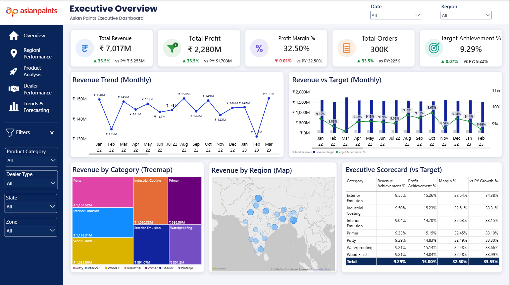
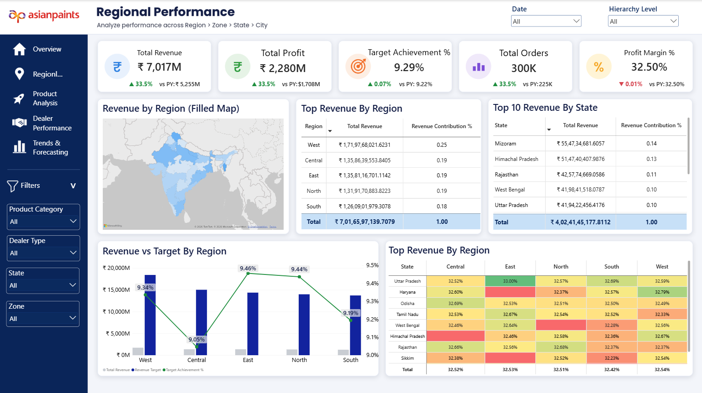
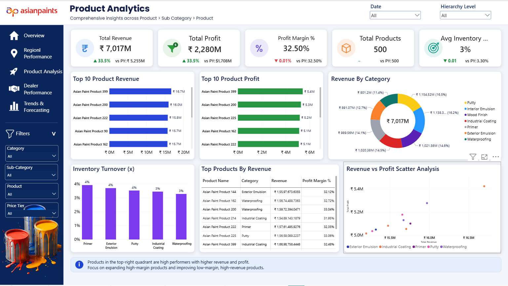
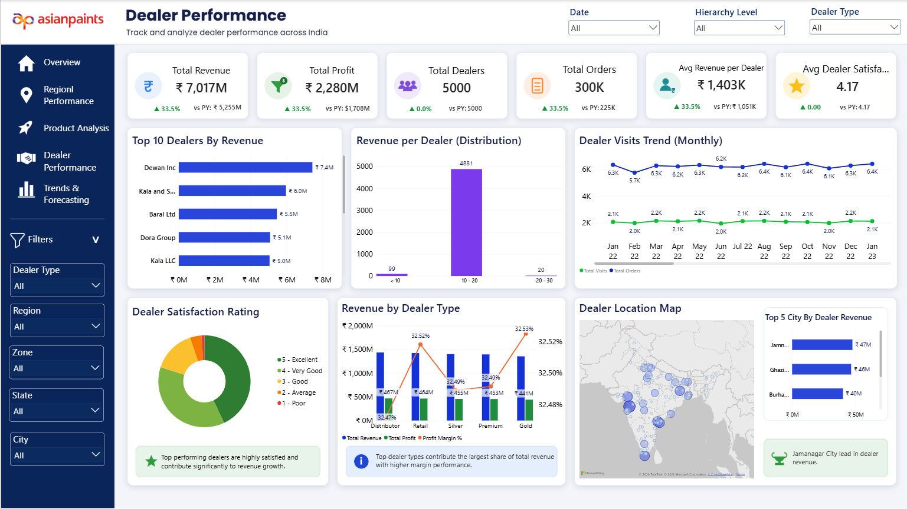
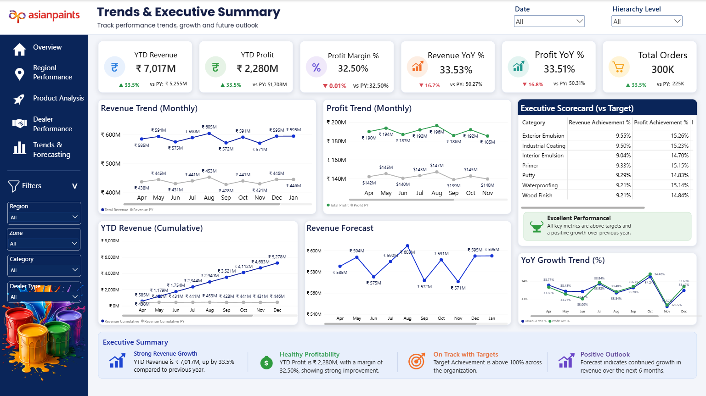

<div align="center">

# 🎨 Asian Paints – Sales & Performance Analytics Dashboard
### *Power BI Sales, Regional, Product & Dealer Analytics Project*


**Power BI · Asian Paints Business Performance Dashboard Project**

</div>

---

<a id="table-of-contents"></a>
# 📋 Table of Contents

- [📌 Overview](#overview)
- [🎯 Objective](#objective)
- [📦 Data Model](#data-model)
- [🏗️ Repository Structure](#repository-structure)
- [🗂️ Report Pages](#report-pages)
  - [📊 Page 1: Executive Overview](#page-1-executive-overview)
  - [🗺️ Page 2: Regional Performance](#page-2-regional-performance)
  - [🎨 Page 3: Product Analytics](#page-3-product-analytics)
  - [🤝 Page 4: Dealer Performance](#page-4-dealer-performance)
  - [📈 Page 5: Trends & Executive Summary](#page-5-trends-executive-summary)
- [🔍 Filters & Slicers](#filters-slicers)
- [💡 Key Insights](#key-insights)
- [🎨 Theme & Formatting](#theme-formatting)
- [🛠️ Tools & Techniques](#tools-techniques)
- [🚀 How to Use This Project](#how-to-use)
- [🎥 Video Walkthrough](#video-walkthrough)
- [📈 Learning Outcomes](#learning-outcomes)
- [👤 Author](#author)

---

<a id="overview"></a>
# 📌 Overview

The **Asian Paints Sales & Performance Analytics Dashboard** is a five-page Microsoft Power BI report presenting a business-wide view of revenue, profitability, product performance, dealer activity, geographic contribution, targets and trends. It uses an Asian Paints-inspired layout with a navy-blue navigation panel, KPI cards, charts, maps, tables and interactive slicers.

The report includes **five pages**:

- 📊 **Executive Overview:** headline KPIs, monthly revenue trends, revenue versus target, category contributions and an executive scorecard.
- 🗺️ **Regional Performance:** region-to-city geographic analysis, regional and state revenue rankings, target achievement and a region/state comparison matrix.
- 🎨 **Product Analytics:** top products by revenue and profit, category mix, inventory turnover, product-level profitability and a revenue-versus-profit scatter plot.
- 🤝 **Dealer Performance:** dealer KPIs, top dealers, revenue distribution, dealer visits, satisfaction ratings, dealer types and locations.
- 📈 **Trends & Executive Summary:** year-to-date revenue and profit, year-over-year growth, monthly trends, cumulative revenue, forecasts and executive reporting.


---

<a id="objective"></a>
# 🎯 Objective

The main objective is to build an interactive business performance report that enables users to:

- Monitor total revenue, total profit, profit margin and order volume.
- Compare current results with previous-year values and growth percentages.
- Evaluate revenue and profit against target measures.
- Explore geographic performance through region, zone, state and city views.
- Identify leading product categories and high-performing products.
- Compare product revenue, profit and inventory-turnover metrics.
- Measure dealer contribution, activity and satisfaction.
- Examine monthly, cumulative and year-over-year trends.
- Present executive-level summaries through five connected report pages.

---

<a id="data-model"></a>
# 📦 Data Model


| Business area | Information visible in the report |
|---|---|
| Sales & Orders | Total revenue, order count, monthly revenue, previous-year comparisons |
| Profitability | Total profit, profit margin, product profit, profit trends |
| Products | Product, sub-category, category, product counts, inventory turnover |
| Geography | Region, zone, state, city, geographic revenue contribution |
| Dealers | Dealer, dealer type, visits, satisfaction, dealer revenue |
| Time & Targets | Date, monthly trends, YTD totals, target comparisons and growth |


---


<a id="repository-structure"></a>
# 🏗️ Repository Structure

Suggested GitHub repository layout (the actual project folders and `.pbix` filename were not shown):

```text
📦 Asian-Paints-Power-BI-Dashboard
│
├── 📊 Asian Paints Dashboard.pbix      → Power BI report (add your actual file)
│
├── 📁 Dataset                          → Source files (if sharing is permitted)
│
├── 📁 Assets
│   └── 📁 Images
│       ├── Executive_Overview.png
│       ├── Regional_Performance.png
│       ├── Product_Analytics.png
│       ├── Dealer_Performance.png
│       └── Trends_Executive_Summary.png
│
└── 📝 README.md                        → Project documentation
```

The accompanying ZIP package contains this README and the five screenshots already named to match the image links below. Add your `.pbix` and source data separately if you want them in the repository.

---

<a id="report-pages"></a>
# 🗂️ Report Pages

<a id="page-1-executive-overview"></a>
## 📊 Page 1: Executive Overview

The **Executive Overview** page summarizes the headline financial and sales metrics, tracks monthly revenue and targets, and compares performance across product categories and geographic locations.

### KPI Cards

| KPI | Value displayed | Previous-year comparison shown |
|---|---:|---|
| 💰 Total Revenue | **₹7,017M** | ₹5,255M; ▲ 33.5% |
| 💵 Total Profit | **₹2,280M** | ₹1,708M; ▲ 33.5% |
| 📊 Profit Margin | **32.50%** | 32.50%; ▼ 0.01% shown |
| 🧾 Total Orders | **300K** | 225K; ▲ 33.5% |
| 🎯 Target Achievement | **9.29%** | 9.22%; ▲ 0.07% shown |

### Visuals

| Visual | Analysis |
|---|---|
| Revenue Trend (Monthly) | Monthly revenue changes across the visible timeline |
| Revenue vs Target (Monthly) | Compares revenue, revenue target and target-achievement percentages |
| Revenue by Category (Treemap) | Compares category contributions including Putty, Interior Emulsion and Industrial Coating |
| Revenue by Region (Map) | Displays revenue distribution across India |
| Executive Scorecard (vs Target) | Shows revenue achievement, profit achievement, margin and prior-year growth by category |

### Revenue by Category

| Category | Revenue shown |
|---|---:|
| Putty | ₹1,154.52M |
| Interior Emulsion | ₹1,138.31M |
| Wood Finish | ₹1,021.56M |
| Industrial Coating | ₹1,020.38M |
| Primer | ₹989.56M |
| Exterior Emulsion | ₹891.07M |
| Waterproofing | ₹801.20M |

### 📸 Dashboard Screenshot



---

<a id="page-2-regional-performance"></a>
## 🗺️ Page 2: Regional Performance

The **Regional Performance** page compares revenue and target-achievement measures across regions and states. The page title indicates a geographic drill path of **Region → Zone → State → City**.

### KPI Cards

| KPI | Value displayed |
|---|---:|
| 💰 Total Revenue | ₹7,017M |
| 💵 Total Profit | ₹2,280M |
| 🎯 Target Achievement | 9.29% |
| 🧾 Total Orders | 300K |
| 📊 Profit Margin | 32.50% |

### Visuals

| Visual | Analysis |
|---|---|
| Revenue by Region (Filled Map) | Maps regional revenue across India |
| Top Revenue by Region | Compares regional revenue and contribution |
| Top 10 Revenue by State | Ranks states by displayed revenue |
| Revenue vs Target by Region | Compares regional revenue, targets and achievement percentages |
| Regional Performance Matrix | Heatmap-style comparison of percentages by state and region |

### Regional Revenue Contribution

| Region | Share displayed |
|---|---:|
| West | 25% |
| Central | 19% |
| East | 19% |
| North | 19% |
| South | 18% |

### Regional Target Achievement

| Region | Percentage displayed |
|---|---:|
| West | 9.34% |
| Central | 9.05% |
| East | 9.46% |
| North | 9.44% |
| South | 9.19% |


### 📸 Dashboard Screenshot



---

<a id="page-3-product-analytics"></a>
## 🎨 Page 3: Product Analytics

The **Product Analytics** page compares individual products and paint categories using revenue, profit, inventory-turnover indicators and product-level performance visuals. Its subtitle describes the hierarchy **Product → Sub Category → Product**.

### KPI Cards

| KPI | Value displayed |
|---|---:|
| 💰 Total Revenue | ₹7,017M |
| 💵 Total Profit | ₹2,280M |
| 📊 Profit Margin | 32.50% |
| 📦 Total Products | 500 |
| 📉 Inventory-related KPI (title truncated in screenshot) | 3% |

### Visuals

| Visual | Analysis |
|---|---|
| Top 10 Product Revenue | Ranks products by revenue |
| Top 10 Product Profit | Ranks products by profit |
| Revenue by Category | Shows category revenue mix in a doughnut chart |
| Inventory Turnover (x) | Compares the displayed turnover measure across categories |
| Top Products by Revenue | Product-level table including category, revenue and profit margin |
| Revenue vs Profit Scatter Analysis | Compares product revenue against profit |

### Selected Product Highlights

| Product | Displayed metric |
|---|---|
| Asian Paint Product 399 | Approximately ₹16.7M revenue and ₹5.4M profit |
| Asian Paint Product 200 | Approximately ₹16.0M revenue |
| Asian Paint Product 225 | Approximately ₹5.2M profit |


### 📸 Dashboard Screenshot



---

<a id="page-4-dealer-performance"></a>
## 🤝 Page 4: Dealer Performance

The **Dealer Performance** page analyzes dealer contribution, sales activity, satisfaction ratings and geographic coverage.

### KPI Cards

| KPI | Value displayed |
|---|---:|
| 💰 Total Revenue | ₹7,017M |
| 💵 Total Profit | ₹2,280M |
| 🤝 Total Dealers | 5,000 |
| 🧾 Total Orders | 300K |
| 💳 Avg Revenue per Dealer | ₹1,403K |
| ⭐ Avg Dealer Satisfaction | 4.17 |

### Visuals

| Visual | Analysis |
|---|---|
| Top 10 Dealers by Revenue | Ranks dealers by revenue |
| Revenue per Dealer (Distribution) | Shows the distribution of dealer-level revenue values |
| Dealer Visits Trend (Monthly) | Compares monthly total visits and total orders |
| Dealer Satisfaction Rating | Shows ratings from 1 (Poor) to 5 (Excellent) |
| Revenue by Dealer Type | Compares revenue, profit and margin across dealer types |
| Dealer Location Map | Displays dealer locations and a top-city revenue comparison |

### Selected Dealer Revenue Rankings

| Dealer | Revenue shown |
|---|---:|
| Dewan Inc | ₹7.4M |
| Kala and S... (name truncated in visual) | ₹6.0M |
| Baral Ltd | ₹5.5M |
| Dora Group | ₹5.1M |
| Kala LLC | ₹5.0M |

The dealer revenue distribution chart shows **99** dealers in the lowest displayed band, **4,881** in the middle band and **20** in the highest band. The page callouts emphasize strong dealer satisfaction and identify **Jamnagar** as the leading city in the visible dealer revenue comparison.

### 📸 Dashboard Screenshot



---

<a id="page-5-trends-executive-summary"></a>
## 📈 Page 5: Trends & Executive Summary

The **Trends & Executive Summary** page consolidates year-to-date results, growth rates, monthly comparisons, cumulative performance and the revenue forecast visual.

### KPI Cards

| KPI | Value displayed |
|---|---:|
| 💰 YTD Revenue | ₹7,017M |
| 💵 YTD Profit | ₹2,280M |
| 📊 Profit Margin | 32.50% |
| 📈 Revenue YoY | 33.53% |
| 📈 Profit YoY | 33.51% |
| 🧾 Total Orders | 300K |

### Visuals

| Visual | Analysis |
|---|---|
| Revenue Trend (Monthly) | Compares monthly revenue with previous-year revenue |
| Profit Trend (Monthly) | Compares monthly profit with previous-year profit |
| YTD Revenue (Cumulative) | Shows cumulative revenue progression and previous-year values |
| Revenue Forecast | Displays the revenue outlook in a time-series chart |
| Executive Scorecard (vs Target) | Compares category-level revenue and profit achievement percentages |
| YoY Growth Trend (%) | Compares revenue and profit growth trends |
| Executive Summary | Highlights revenue growth, profitability, target messaging and outlook |

### Executive Highlights

- **Revenue growth:** YTD revenue is shown as **₹7,017M**, with approximately **33.5%** growth over the previous year.
- **Profitability:** YTD profit is **₹2,280M**, with a **32.50%** margin.
- **Orders:** The dashboard shows **300K** total orders.
- **Outlook:** The page contains a revenue forecast visual and a positive-outlook callout.


### 📸 Dashboard Screenshot



---

<a id="filters-slicers"></a>
# 🔍 Filters & Slicers

The report uses page-specific slicers in the top header and left sidebar.

| Page | Visible filters |
|---|---|
| Executive Overview | Date, Region, Product Category, Dealer Type, State, Zone |
| Regional Performance | Date, Hierarchy Level, Product Category, Dealer Type, State, Zone |
| Product Analytics | Date, Hierarchy Level, Category, Sub-Category, Product, Price Tier |
| Dealer Performance | Date, Hierarchy Level, Dealer Type, Region, Zone, State, City |
| Trends & Executive Summary | Date, Hierarchy Level, Region, Zone, Category, Dealer Type |

The left navigation allows switching between **Overview, Regional Performance, Product Analysis, Dealer Performance, and Trends & Forecasting**.

---

<a id="key-insights"></a>
# 💡 Key Insights

Based on the five supplied screenshots:

- 💰 **₹7,017M total revenue** and **₹2,280M total profit** are displayed across the report.
- 📊 The dashboard reports a **32.50% profit margin** and **300K orders**.
- 📈 The Executive Overview shows **33.5%** revenue and profit growth versus previous-year values.
- 🧩 **Putty** has the largest displayed category revenue at **₹1,154.52M**, followed by **Interior Emulsion** at **₹1,138.31M**.
- 🗺️ **West** contributes the largest displayed share of regional revenue (**25%**).
- 🎯 **East** has the highest displayed regional target-achievement percentage (**9.46%**).
- 🎨 The Product Analytics page reports **500 products**; Product 399 leads the visible revenue ranking at approximately **₹16.7M**.
- 🤝 The Dealer Performance page reports **5,000 dealers** and **₹1,403K average revenue per dealer**.
- ⭐ Average dealer satisfaction is **4.17** on the displayed rating measure.
- 📈 The Trends page reports **33.53% Revenue YoY** and **33.51% Profit YoY**.


---

<a id="theme-formatting"></a>
# 🎨 Theme & Formatting

### Design

- Asian Paints-inspired branding and a white header.
- Dark navy-blue sidebar with page-navigation icons and filter controls.
- White KPI cards with colored circular icons and year-over-year indicators.
- Blue, green, purple, orange and yellow accents across visualizations.
- Rounded chart containers, compact tables and map visuals.
- Conditional formatting in regional comparison matrices.
- Paint-can imagery on the product, dealer and trends pages.

### Dashboard Layout

- **Executive Overview:** headline KPI cards, revenue trends and targets, category treemap, map and scorecard.
- **Regional Performance:** headline KPIs, filled map, regional/state rankings, target chart and heatmap matrix.
- **Product Analytics:** product KPIs, revenue/profit rankings, category mix, inventory view, product table and scatter plot.
- **Dealer Performance:** dealer KPIs, rankings, visits, ratings, dealer-type analysis and location map.
- **Trends & Executive Summary:** YTD KPIs, revenue/profit trends, cumulative revenue, forecast, scorecard and summary callouts.

---

<a id="tools-techniques"></a>
# 🛠️ Tools & Techniques

| Tool / Feature | Purpose |
|---|---|
| Microsoft Power BI Desktop | Multi-page dashboard development and visualization |
| Power Query Editor | Data preparation and transformation, if used in the PBIX |
| DAX Measures | Calculating KPIs, time comparisons and target measures, where implemented |
| KPI / Card Visuals | Revenue, profit, margin, orders, product and dealer metrics |
| Line Charts | Revenue, profit, visits and growth trends |
| Column / Bar Charts | Product, region, dealer and target comparisons |
| Treemap & Doughnut Charts | Product-category revenue distribution and satisfaction mix |
| Scatter Chart | Revenue-versus-profit product analysis |
| Maps / Filled Maps | Regional revenue and dealer geographic analysis |
| Tables & Matrices | Product rankings, scorecards and region/state comparisons |
| Slicers & Navigation | Page-level filtering and report navigation |
| Hierarchy Analysis | Geographic and product-level exploration |
| Conditional Formatting | Color-based comparison in performance matrices |


---

<a id="how-to-use"></a>
# 🚀 How to Use This Project

1. **Clone** or download the GitHub repository.
2. Open the Asian Paints `.pbix` report file using **Microsoft Power BI Desktop** (add the actual report file to the repository).
3. If prompted for missing data sources, open **Home → Transform data → Data source settings** and update the source paths to your local dataset.
4. Select **Refresh** after connecting the data.
5. Use the left navigation to explore the five report pages.
6. Apply the Date, Region, Category, Dealer Type and other page-specific filters to focus the analysis.
7. Review the maps, charts, tables and executive summaries for the selected filters.

**Note:** The original PBIX file, dataset paths and model schema were not supplied with the screenshots, so they are not included in the accompanying README package.

---

<a id="video-walkthrough"></a>
# 🎥 Video Walkthrough

A walkthrough can be added here to demonstrate all five report pages, slicers, charts and key findings.

🔗 **[Watch the video here](https://drive.google.com/file/d/1a6NSx5x9vvJbeeNvt5DR4T4dqsOaN1bp/view?usp=sharing)**

---

<a id="learning-outcomes"></a>
# 📈 Learning Outcomes

- ✅ Design a consistent five-page Power BI business dashboard.
- ✅ Present revenue, profit, margin, order and target metrics.
- ✅ Compare business performance with previous-year values.
- ✅ Build regional and geographic performance views.
- ✅ Analyze product revenue, profit and category contribution.
- ✅ Review dealer rankings, visits, satisfaction and locations.
- ✅ Use tables, matrices, scatter plots, maps and distribution visuals.
- ✅ Present monthly, cumulative, YTD and year-over-year trends.
- ✅ Organize executive reporting through navigation and slicers.
- ✅ Communicate business insights with clear visual storytelling.

---

<a id="author"></a>
# 👤 Author

<div align="center">

# Tirth Donga

[](https://github.com/tirthdonga)

**Asian Paints – Sales & Performance Analytics Dashboard | Power BI Project**

*Power BI · Business Analytics · Data Visualization*

---

### ⭐ Thank You For Visiting This Project ⭐

Made with ❤️ using Microsoft Power BI

</div>
